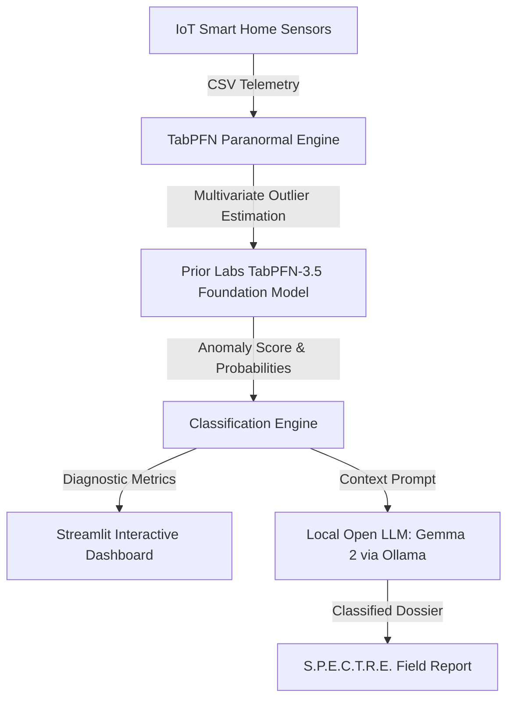

# 👻 TabPFN Paranormal: IoT Poltergeist Investigator

> **Hacktoberfest 2026 Open-Source AI Challenge (Week 4: Ghost in the Machine)**  
> *Targeted Prize: Best Use of TabPFN ($200) & Top Overall Winner*

An edge-native, open-source paranormal anomaly detection and intelligence system that analyzes smart-home environmental telemetry (temperature, electromagnetic fields, infrasound frequency, acoustic decibels, and circuit wattage) to detect, isolate, and classify "ghosts in the machine".

Powered by **Prior Labs' TabPFN-3.5 foundation model** and **Local Open LLMs (Google Gemma 2 via Ollama)**.

---

## 🌟 Key Features

1. **Prior Labs TabPFN Bayesian Inference Engine:**
   - Evaluates multi-channel tabular telemetry in a single forward pass without hyperparameter tuning.
   - Detects multivariate outliers (sudden 3:00 AM temperature collapses paired with magnetic spikes).
   - Generates probabilistic classification across 4 diagnostic hypotheses:
     - 👻 *Class-IV Poltergeist / Spectral Manifestation*
     - ❄️ *HVAC Thermal Cycling (Mundane Compressor Defrost)*
     - ⚡ *Mains Electrical Ground Loop / Transient Surge*
     - 📳 *18.9 Hz Infrasonic Acoustic Vent Resonance*

2. **Classified S.P.E.C.T.R.E. Dossier Synthesis (Local Gemma 2):**
   - Pairs TabPFN quantitative outputs with **Google Gemma 2** running locally through Ollama.
   - Synthesizes top-secret field intelligence dossiers with containment procedures, forensic anomaly explanations, and actionable mitigation protocols.

3. **100% Air-Gapped Domestic Privacy:**
   - Domestic sensor telemetry reveals intimate living habits (sleep cycles, occupancy, daily schedules).
   - TabPFN Paranormal runs 100% on local edge hardware; no personal telemetry is ever sent to proprietary cloud APIs.

4. **Interactive Radar & Time-Series Visualizer:**
   - Multi-axis synchronized time-series plots.
   - Diagnostic probability radar charts and threat gauges.
   - 3 pre-loaded real-world & paranormal baseline datasets.
   - Built-in CSV uploader for any Home Assistant / IoT telemetry export.

---

## 🏗️ Architecture



---

## 🚀 Quickstart

### 1. Clone & Install Dependencies
```bash
git clone https://github.com/your-username/tabpfn-paranormal.git
cd tabpfn-paranormal

# Install requirements
pip install -r requirements.txt
```

### 2. (Optional) Run Local Gemma 2 via Ollama
If you want live LLM generation for dossiers:
```bash
# In a separate terminal
ollama run gemma2
```
*(Note: If Ollama is not running, the application seamlessly switches to its autonomous built-in synthetic dossier engine!)*

### 3. Launch the Application
```bash
streamlit run app.py
```
Open your browser to `http://localhost:8501`.

---

## 🔒 Why Open Innovation Matters

Smart-home sensors record when you are awake, asleep, in the shower, or away from home. Feeding this raw telemetry into closed commercial APIs (like OpenAI or cloud brokers) creates dangerous physical privacy risks:
- Commercial surveillance and ad-targeting based on daily routines.
- Risk of corporate data breaches exposing floorplans and occupancy maps.
- Reliance on internet connectivity that fails during storms or power surges.

By contrast, **Prior Labs' TabPFN** and **Gemma 2** running on local hardware:
- Guarantee 100% air-gapped data ownership.
- Operate autonomously with zero latency and zero cloud API fees.
- Keep the digital sanctity of the home safe from both corporeal surveillance and digital apparitions.

---

## 📜 License
MIT Open Source License — Built with pride for Hacktoberfest 2026.
